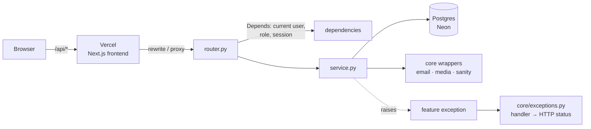

# Architecture

## Feature-based structure

Code is grouped **by feature**, not by technical layer. Everything about users lives in `users/`, everything about wishes in `wishes/`, and so on. When you work on a feature you mostly stay inside one folder.

```
src/app/
├── main.py              # creates the FastAPI app, middleware, registers routers
├── core/                # cross-cutting code shared by all features
│   ├── config.py        # settings from environment variables (pydantic-settings)
│   ├── database/        # everything SQLAlchemy needs to talk to Postgres
│   │   ├── base.py      # the shared declarative Base
│   │   ├── engine.py    # async engine + session factory (SessionLocal)
│   │   └── session.py   # get_session dependency
│   ├── security.py      # JWT, password hashing, hashing of codes and refresh tokens
│   ├── exceptions.py    # base exceptions + handlers that turn them into HTTP responses
│   ├── pagination.py    # page/limit query parameters and the Page[T] response
│   ├── email.py         # the only place that sends email
│   ├── media.py         # Cloudinary wrapper (profile photos)
│   ├── sanity.py        # Sanity HTTP API client (blog posts)
│   └── fakes.py         # in-memory fakes of email, media and sanity, for tests only
├── auth/                # login, codes, sessions/tokens, role + ownership checks
├── users/               # users (incl. profile fields), sub-families, promotions, admin management
├── wishes/              # birthday wishes and upcoming birthdays
└── posts/               # blog posts (stored in Sanity) and the posts cache

alembic/                 # database migrations
tests/                   # cross-feature and end-to-end tests
conftest.py              # shared pytest fixtures (applies to all tests)
scripts/                 # one-off scripts (v1 data import, first-admin seed)
docs/                    # you are here
```

### Inside a feature

Every feature uses the same files, so you always know where to look:

| File | Responsibility |
|---|---|
| `router.py` | HTTP endpoints. Parse the request, call the service, return the response. **No business logic, no DB queries.** |
| `schemas.py` | Pydantic models: what the API accepts and returns (e.g. `UserCreate`, `UserRead`). |
| `models.py` | SQLAlchemy models: what the database stores. Only in features that own tables (`posts` has none, because posts live in Sanity). |
| `service.py` | Business logic and data access. This is where the real work happens. |
| `dependencies.py` | FastAPI `Depends` helpers specific to the feature. |
| `exceptions.py` | Exceptions the feature raises (e.g. `WishAlreadySent`). |
| `tests/` | Tests for this feature (`test_service.py`, `test_router.py`). |

> **schemas vs models.** `schemas.py` = Pydantic (API shape). `models.py` = SQLAlchemy (DB shape). Never mix them, and never return a SQLAlchemy model directly. Always declare a `response_model`, so internal fields like `password_hash` can't leak.

## How a request flows



1. The browser calls `/api/...` on the **frontend's own domain**. Vercel forwards it to our backend on Render (see [Authentication](auth.md#why-the-vercel-proxy) for why).
2. The **router** validates input through Pydantic schemas. Dependencies load the DB session and the current user and check the role.
3. The **service** does the work: it talks to the database and, through `core/`, to email, Cloudinary or Sanity.
4. If something goes wrong, the service raises a **feature exception**. A handler in `core/exceptions.py` maps it to the right HTTP status. We never return a `200` with an error inside.

**Error responses** all have the same body, so the frontend can handle them in one place:

```json
{"error": {"code": "wish_already_sent", "message": "You already wished this member a happy birthday this year."}}
```

- `code` is stable and machine-readable; `message` is for people and may change.
- Feature exceptions subclass a common one (`BadRequest` 400, `Unauthorized` 401, `Forbidden` 403, `NotFound` 404, `Conflict` 409, `TooManyRequests` 429) and set their own `code` and default message.
- Validation errors (422, code `validation_error`) add a `details` list of `{field, message}`. Unlike FastAPI's default, they never echo the submitted values, which may be codes or passwords.
- Unknown routes and wrong methods use the same shape. Unexpected errors return a generic 500 with no internal details.

There is **no controller layer**. Routers *are* the controllers. If queries ever get complicated enough to need a repository layer, discuss it with the team first.

## Rules for code across features

- **Imports between features:** a feature may import another feature's `service` or `schemas`, never its `router` or internals. For example, `wishes` can call `users.service` to look up a recipient.
- **Circular imports:** use string references in relationships (`relationship("User")`) and `if TYPE_CHECKING:` imports for type hints. If two features constantly need each other, they may belong together.
- **One `Base`:** all models inherit from the single `Base` in `core/database/base.py`. Import it with `from app.core.database.base import Base`, not from the `core.database` package, so that loading a model never creates the database engine.
- **Alembic must see every model:** when you add a `models.py`, import it in `alembic/env.py`, or autogenerate won't notice your tables.

## Conventions

- **Async all the way.** Use `async def` endpoints and `AsyncSession`. Never make blocking calls inside `async def`. Use `httpx` for HTTP. Wrap the (sync) Cloudinary SDK with `run_in_threadpool`.
- **Typed SQLAlchemy 2.x:** use `Mapped[...]` and `mapped_column`, with full type hints everywhere (mypy runs in strict mode).
- **Database constraints, not "check then insert":** uniqueness such as family names or one wish per year is enforced by unique indexes.
- **Configuration** only comes from `core/config.py`. When you add a variable, add it to `.env.example` too.
- **API paths** are RESTful under `/api/v1` (e.g. `GET /api/v1/users/{id}`). We didn't keep v1's endpoint names.
- **Pagination:** list endpoints take `page` (from 1) and `limit` (default 20, at most 100) and return `{items, total, page, limit}`, through `Pagination` and `Page[T]` in `core/pagination.py`.
- **Logging:** use the `logging` module, never `print`. **Never log** request bodies, codes, tokens or email addresses.

## Testing

- Feature tests live next to the feature (`src/app/<feature>/tests/`). Cross-feature tests go in `tests/`.
- Tests run against a **real Postgres** (Docker locally, a service container in CI), never SQLite. Each test runs inside a transaction that's rolled back afterwards, so tests don't affect each other.
- External services (email, Sanity, Cloudinary) are **mocked at the `core/` wrapper**, never deep inside a service.
- Every endpoint gets tests for the success path, unauthenticated and unauthorized access (role and ownership), and its main failure cases.

```bash
uv run pytest                                 # everything
uv run pytest src/app/wishes/tests            # one feature
uv run pytest path/to/test_x.py::test_name    # one test
```

## Adding a new feature: checklist

1. Fill in the feature's `models.py`, `schemas.py`, `service.py` and `router.py`.
2. Register the router in `main.py`.
3. Import the models in `alembic/env.py`, run `uv run alembic revision --autogenerate -m "..."`, and **read the generated migration**.
4. Write tests in the feature's `tests/` folder.
5. Run `uv run ruff check . --fix`, `uv run ruff format .` and `uv run pytest` before opening a PR.
6. Ask the team before adding a new top-level folder, a new layer or a new external service.
