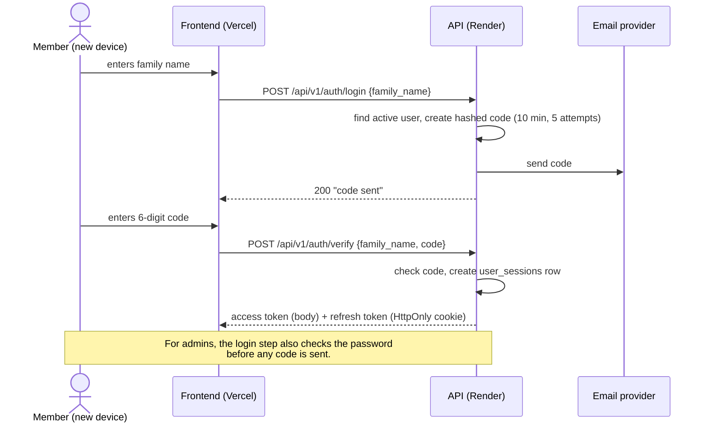
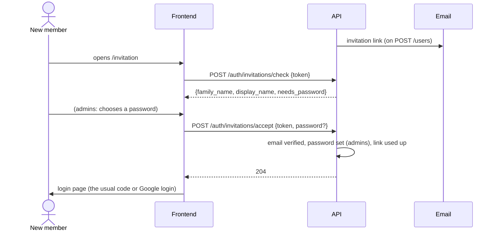

# Authentication

## The idea: log in once per device

A family name is easy to know, so on its own it must **never** be enough to get into an account. v1 got this wrong: anyone who knew a family name could log in as that person.

In v2, **each new device has to prove itself once**, and after that it stays logged in:

- **Members and social media managers:** family name, then a **6-digit code emailed** to their address, **or "Sign in with Google"** with the Google account that uses that address.
- **Admins:** their **password** plus a second proof: either family name + password, then an emailed code, or password + Google (the Google account already says who they are, so no family name is needed).

Google proves the same thing a code does (that the person owns the email address), so it's an alternative to the code, never a way around it. It works on a first login too, and like a first code it marks the email as verified. No login method ever creates an account: admins register every member, and each new member is emailed an invitation link first (see [Invitations](#invitations)).

After that, the device holds a long-lived **refresh token** and doesn't have to log in again for up to 90 days of inactivity. Someone who knows your family name but not your inbox (or password) can't get in from their own device.

## Login flow (member)

## Endpoints

All under `/api/v1/auth`. The login, invitation, refresh and logout endpoints don't need an access token; the session endpoints do.

### `POST /login` — step one on a new device

Body: `{"family_name": "...", "password": "..."}`. Only admins send `password`; members leave it out. The family name ignores case and surrounding spaces.

| Who | Response | Email |
|---|---|---|
| member or social media manager | 200 `{message, expires_in: 600, resend_after: 60}` | code sent |
| admin with the right password | the same 200 | code sent |
| unknown family name, deactivated user, or admin **without** a password | the same 200 | **none** |
| anyone who sent a password that isn't an admin's correct one | 401 `invalid_credentials` | none |

The 200 is identical in every case, so the endpoint doesn't say which family names exist or who is an admin. A sent password always costs the same Argon2 time. A few answers do only happen for real accounts: the 429 limits (`code_recently_sent`, `too_many_codes`) and an email failure (503 `email_not_sent` / `email_not_configured`). We accept that, because telling a real member what went wrong matters more, and family names aren't secret anyway; the code is what protects the account.

**Password checks are capped.** Anyone can make the server check a password, even for a family name that doesn't exist, so hashing is kept cheap and limited: Argon2id with OWASP's settings (19 MiB, 2 passes), and at most **2 hashes at a time**. Others wait their turn; one that has waited 5 seconds gets 429 `password_check_busy` ("Too many sign-ins at once"), and the user can simply try again. The same cap covers `POST /auth/google` for admins and an admin accepting their invitation.

> **Frontend:** give admins a way to enter their password (for example an "I'm an admin" link that shows the field). An admin who logs in without it gets the normal "code is on its way" answer, but no email.

### `POST /verify` — step two: the code logs the device in

Body: `{"family_name": "...", "code": "123456"}`. Spaces around the code are ignored; anything other than 6 ASCII digits is a 422.

- **Right code:** 200 `{"access_token", "token_type": "bearer", "expires_in": 900}`, plus the refresh cookie (see [Tokens](#tokens)). A new `user_sessions` row is created, labelled from the `User-Agent` (e.g. "Safari on iPhone"), and the first successful code sets `email_verified_at`.
- **Anything else** (wrong, used, expired, out of attempts, an older code, someone else's code, an unknown or deactivated user): 401 `invalid_code`, and no cookie.

Every way of logging in ends in `start_session` (`auth/service.py`), which creates the session and the tokens, so a device logged in with Google behaves exactly the same from then on.

### `POST /google` — log in with Google instead of a code

Body: `{"id_token": "...", "password": "..."}`. `id_token` is the credential that Google's sign-in button gives the frontend; only admins send `password`.

The API checks the token itself (`core/google.py`): Google's signature, `iss` is Google, `aud` is our `GOOGLE_CLIENT_ID`, it hasn't expired, and `email_verified` is true. It then looks for the **active** user whose email matches the token's, ignoring case.

| Situation | Response |
|---|---|
| member or social media manager | 200, same body and cookie as `/verify`; sets `email_verified_at` if it was empty |
| admin with the right password | the same 200 |
| admin without a password | 401 `admin_password_required` |
| admin with a wrong password | 401 `invalid_credentials` |
| no active user has that email | 401 `google_account_not_registered` |
| token not from Google, for another app, or expired | 401 `invalid_google_token` |
| Google says the email isn't verified | 401 `google_email_not_verified` |
| Google's keys can't be fetched | 502 `google_unavailable` (the code login still works) |
| `GOOGLE_CLIENT_ID` isn't set | 503 `google_not_configured` |

Unlike `/login`, these errors name their cause. Only the person who signed in to that Google account can see them, so they reveal nothing to anyone else, and `google_account_not_registered` helps a member spot a typo in the email an admin entered.

The match is by email, not by Google's account ID, so an admin can fix a wrong email and the member's next Google login simply works. Members without a Google account (or with a different address) keep using codes.

> **Frontend:** use Google Identity Services' button with the same client ID, and post its `credential` here. For admins, ask for the password first and send it along.

### `POST /refresh` — a new access token

No body. The browser sends the refresh cookie by itself, and the request must carry our `Origin` (see [Why the Vercel proxy](#why-the-vercel-proxy)).

| Situation | Response |
|---|---|
| the current refresh token | 200 with a new access token, and a **new** refresh cookie; the session's 90 days start again |
| the token this one replaced, **within 30 seconds** of the replacement | 409 `refresh_conflict`: another tab refreshed at the same moment. **Retry once**: the browser already has the new cookie |
| the replaced token, **later than that** | 401 `session_ended`, and the whole session is revoked: someone else has a copy of the token |
| no cookie | 401 `not_authenticated` |
| unknown token, revoked or expired session, deactivated user | 401 `session_ended` |
| missing or foreign `Origin` | 403 `origin_not_allowed` |

### `POST /logout` — log this device out

No body; it needs the cookie and our `Origin`, like refresh. It revokes this device's session (the replaced token works too) and clears the cookie, then returns 204. With no cookie or an unknown token it still returns 204, so the frontend can always treat logout as done. Other devices stay logged in. A missing or foreign `Origin` gets 403 `origin_not_allowed`.

> **Frontend:** when a call returns 401 `token_expired`, call `/refresh` once and retry the call. On 409, retry the refresh after a short pause. On any other refresh error, send the user to the login page. Make concurrent calls share one refresh rather than each starting its own.

### `GET /sessions` — your logged-in devices

Needs an access token. Returns a page (`?page=&limit=`) of the caller's **active** sessions, most recently used first: `{id, device_label, created_at, last_used_at, expires_at, current}`, where `current` marks the device making the request. Revoked and expired sessions aren't listed, and token hashes never leave the server.

Admins can add `?user_id=<id>` to see anyone's devices; anyone else gets 403 `not_owner` for another user's ID.

### `DELETE /sessions/{id}` — sign a device out

Needs an access token. Revokes that session: its refresh token stops working at once, and its access token on its next request. Returns 204, also when the session had already ended, so repeating it is safe.

- **Who:** the session's owner, or any admin. Anyone else gets 403 `not_owner`; an unknown ID gets 404 `session_not_found`.
- **This device:** revoking your own current session works too, but `POST /logout` is better for that because it also clears the cookie.

## Tokens

| | Access token | Refresh token |
|---|---|---|
| **Lifetime** | 15 minutes | 90 days, reset on every use |
| **Where the frontend keeps it** | in memory | an `HttpOnly` cookie it can't read |
| **How it's sent** | `Authorization: Bearer …` header | automatically by the browser, only to `/api/v1/auth` |
| **What it's for** | calling the API | getting a new access token |
| **What it is** | a signed JWT holding only the user and session IDs (never the role) | a random string with no meaning of its own |
| **What the server stores** | nothing | an HMAC of it, keyed by `REFRESH_TOKEN_SECRET` |

**How refresh works:**
- When the access token expires, the frontend calls the refresh endpoint. The browser sends the cookie, and the API returns a new access token **and a new refresh token**: it **rotates** on every use.
- If an *old* refresh token is reused more than 30 seconds after it was replaced (a sign it was stolen), that whole session is revoked. Within those 30 seconds it gets a "retry" answer instead, because two tabs refreshing at once is normal.
- Each refresh token is stored only as a **hash** in a `user_sessions` row, together with the user, a device label (from the browser's user agent), the creation and last-used times, and a revoked flag.
- Users can see their own sessions ("devices") and sign any of them out. Admins can revoke anyone's sessions, and deactivating a user revokes all of them.

**Lifetimes are configurable** through `ACCESS_TOKEN_EXPIRES_IN` and `REFRESH_TOKEN_EXPIRES_IN` (in seconds).

**Error codes the frontend should handle:**

| Status | Code | Meaning | Frontend should |
|---|---|---|---|
| 401 | `not_authenticated` | no `Authorization: Bearer` header | log in |
| 401 | `token_expired` | the access token is older than 15 minutes | refresh, then retry |
| 401 | `invalid_token` | the token is malformed, tampered with or signed with another key | log in |
| 401 | `session_ended` | that device was signed out, its session expired, or the user was deactivated (deliberately not saying which) | log in |
| 403 | `insufficient_role` | logged in, but the role is too low | show "not allowed" |
| 403 | `not_owner` | logged in, but it's someone else's resource | show "not allowed" |
| 403 | `origin_not_allowed` | a refresh or logout request had no `Origin` header, or one not in `CORS_ORIGINS` | nothing: it means the request didn't come from our site (or the deploy's `CORS_ORIGINS` is wrong) |

## Emailed codes

- **Format and limits:** 6 digits, valid for 10 minutes, single-use, 5 attempts.
- **Only the newest code works.** Asking for a new code makes any earlier one useless.
- **Resends:** one per 60 seconds (429 `code_recently_sent`), and at most **10 codes per user in any 24 hours** (429 `too_many_codes`). Ten codes with five attempts each is 50 guesses a day out of a million possible codes, and it stops anyone flooding a member's inbox or using up the email quota.
- **Wrong, used, expired or exhausted** codes all get the same 401 `invalid_code`, so a guesser learns nothing.
- **Storage:** codes are stored **hashed**, never in plain text. The hash is keyed by `CODE_SECRET`, because there are only a million possible codes: a plain hash could be reversed in seconds.
- **Throttling** is stored in Postgres (there's no Redis).
- **Cleanup:** there's no scheduler, so every login request deletes codes older than 24 hours and sessions that expired or were revoked more than 7 days ago.
- **Sending:** codes are sent **during the request**. If the email provider fails, the user sees an error right away and can try again, instead of waiting for an email that never arrives. A code that couldn't be sent is deleted, so it doesn't trigger the 60-second cooldown.
- **Concurrency:** issuing a code locks the user's row, and checking one locks the code's row, so two requests at once can't both get past the limits or both use the same code. The code is committed *before* the email is sent, so no lock is held while waiting for the provider.
- **`email_verified_at`** is set the first time a code to an address works, an invitation link sent to it is accepted, or Google logs in with it. It doesn't grant access; it tells us the address is real. When an admin changes someone's email, it's cleared, and the new address gets a code (or, if their invitation was still unaccepted, a new invitation link).

## Invitations

Adding someone (`POST /users`) emails them an **invitation link**: `<FRONTEND_URL>/invitation#token=…`. Members accept it to confirm their email address; admins also **choose their own password** with it. No admin ever sets another admin's password.

- **Accepting doesn't log in.** The user then logs in as usual, so a forwarded or stolen email is never enough to get into an account: members still need a code (or Google) on each new device, and admins their password too.
- **Members can log in before accepting.** Their first code proves the address as well, and the link then just confirms it again.
- **The link** works **once**, for **7 days**. Only the newest link works: a new one (a resend, a promotion, a corrected address) replaces the old one. The token is 256 random bits, stored as an HMAC keyed by `CODE_SECRET`.
- **The token is after `#`,** which browsers never send to a server, so it stays out of the frontend host's logs. The page reads it from `location.hash` and posts it, so the token never sits in a URL the API receives either. A link scanner that opens the page changes nothing, because only the page's POST does.
- **Who gets one, and when:**
  - a new user, on `POST /users`;
  - someone **promoted to admin**, to choose their password;
  - someone whose **email an admin corrects** before they accepted: the old link stops working and a new one goes to the new address;
  - on request, with `POST /users/{id}/invitation` (admins): a member who hasn't accepted yet, or **any admin**, which is how a forgotten password is reset.
- **The automatic ones never fail the admin's change.** If the email can't be sent (or `FRONTEND_URL` is empty), the change is saved, `invited_at` stays as it was, and the admin resends. A manual resend reports the error instead (503 `email_not_sent`, `email_not_configured` or `invitations_not_configured`), and allows one per minute (429 `invitation_recently_sent`), so a double click doesn't send two links, the first already dead. **The members imported from v1 have no invitation yet** (`invited_at` null); they'll be invited later.
- **Deactivating** someone cancels their link.

### `POST /invitations/check` — who the link is for

Body: `{"token": "..."}`. Returns 200 `{family_name, display_name, needs_password}` (`needs_password` is true for admins) and changes nothing. A POST, not a GET with the token in the path, so the token stays out of URLs and logs.

### `POST /invitations/accept` — accept it

Body: `{"token": "...", "password": "..."}`. Admins must send `password`, 8 to 256 characters (a shorter or longer one is a 422, and a missing one 400 `password_required`, after which the link still works); members leave it out (one they send anyway is ignored). Sets `email_verified_at` (keeping an earlier time), stores the admin's password hash, and deletes the link. Returns 204 with no body and no cookie.

**Errors for both:** a wrong, used, replaced or expired link, or a deactivated user's, all get 400 `invalid_invitation` ("ask an admin to send a new one").

> **Frontend:** build the `/invitation` page. Read the token from `location.hash`, call `check` to greet the person and decide whether to show a password field, then `accept`, and send them to the login page with their family name filled in. On `invalid_invitation`, tell them to ask an admin for a new link.

## Why the Vercel proxy

The frontend runs on Vercel and the API on Render, which are **different sites** as far as the browser is concerned (`vercel.app` and `onrender.com` are both "public suffixes"). Browsers, Safari especially, block cookies set by a *different* site. If the frontend called the API directly, iPhone users would never keep their refresh cookie and would have to log in with a code every 15 minutes.

**The fix:** the frontend calls `/api/...` on **its own domain**, and Vercel forwards those requests to Render with a rewrite in `vercel.json`. To the browser, the API is the same site, so the refresh cookie is an ordinary first-party cookie.

**What this means for the backend:**
- **Cookie attributes:** the refresh cookie is `HttpOnly; Secure; SameSite=Lax; Path=/api/v1/auth` with **no `Domain` attribute**, so it binds to the frontend's host.
- **Origin check:** refresh and logout also check the request's `Origin` against the allowed frontend origins (`CORS_ORIGINS`), as extra protection against cross-site request forgery (`require_allowed_origin` in `auth/dependencies.py`). A request **without** an `Origin` header is refused: browsers always send one on a POST, so only non-browser clients lack it, and those (Postman, scripts) must set it themselves.
- **CORS** mostly matters for local development. It always lists explicit origins, never `*`.
- **Client IP:** requests reach us through two proxies, so the real IP and user agent come from forwarded headers. IP is never the only thing we throttle on.

> **Frontend team:** the `/api/*` rewrite in `vercel.json` is required. Without it, logins break on Safari.

## Roles and ownership in code

- `get_current_user` reads the access token, then loads the user from the database (role and active status come from there).
- `require_role(Role.X)` lets in role X and above.
- An ownership check (owner or admin) protects edits to profiles and wishes.

See [Domain → Access rules](domain.md#access-rules) for who can do what.
