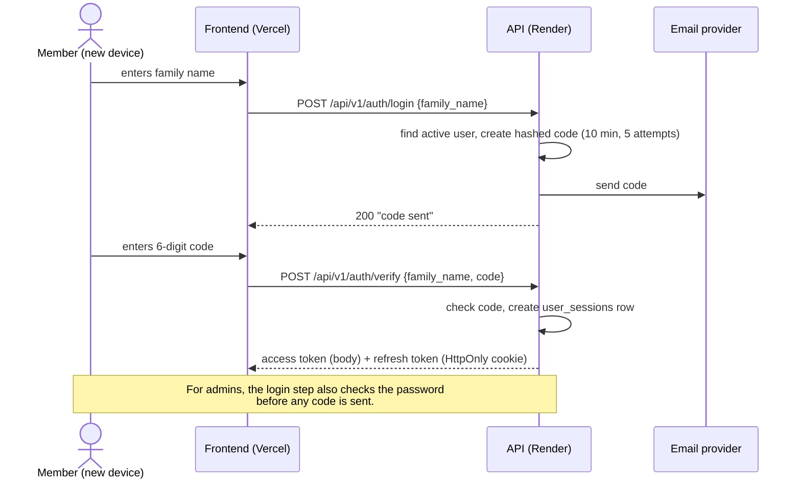

# Authentication

## The idea: log in once per device

A family name is easy to know, so on its own it must **never** be enough to get into an account. v1 got this wrong: anyone who knew a family name could log in as that person.

In v2, **each new device has to prove itself once**, and after that it stays logged in:

- **Members and social media managers:** family name, then a **6-digit code emailed** to their address.
- **Admins:** family name and **password**, then an emailed code (a second factor).

After that, the device holds a long-lived **refresh token** and doesn't have to log in again for up to 90 days of inactivity. Someone who knows your family name but not your inbox (or password) can't get in from their own device.

## Login flow (member)

## Tokens

| | Access token | Refresh token |
|---|---|---|
| **Lifetime** | 15 minutes | 90 days, reset on every use |
| **Where the frontend keeps it** | in memory | an `HttpOnly` cookie it can't read |
| **How it's sent** | `Authorization: Bearer …` header | automatically by the browser, only to `/api/v1/auth` |
| **What it's for** | calling the API | getting a new access token |

**How refresh works:**
- When the access token expires, the frontend calls the refresh endpoint. The browser sends the cookie, and the API returns a new access token **and a new refresh token**: it **rotates** on every use.
- If an *old* refresh token is ever reused (a sign it was stolen), that whole session is revoked.
- Each refresh token is stored only as a **hash** in a `user_sessions` row, together with the user, a device label (from the browser's user agent), the creation and last-used times, and a revoked flag.
- Users can see their own sessions ("devices") and sign any of them out. Admins can revoke anyone's sessions, and deactivating a user revokes all of them.

**Lifetimes are configurable** through `ACCESS_TOKEN_EXPIRES_IN` and `REFRESH_TOKEN_EXPIRES_IN` (in seconds).

## Emailed codes

- **Format and limits:** 6 digits, valid for 10 minutes, single-use, 5 attempts.
- **Resends:** one per 60 seconds.
- **Storage:** codes are stored **hashed**, never in plain text.
- **Throttling** is stored in Postgres (there's no Redis).
- **Sending:** codes are sent **during the request**. If the email provider fails, the user sees an error right away and can try again, instead of waiting for an email that never arrives.
- **`email_verified_at`** is set the first time a code to an address works. It doesn't grant access; it tells us the address is real. When an admin changes someone's email, it's cleared and a code goes to the new address.

## Why the Vercel proxy

The frontend runs on Vercel and the API on Render, which are **different sites** as far as the browser is concerned (`vercel.app` and `onrender.com` are both "public suffixes"). Browsers, Safari especially, block cookies set by a *different* site. If the frontend called the API directly, iPhone users would never keep their refresh cookie and would have to log in with a code every 15 minutes.

**The fix:** the frontend calls `/api/...` on **its own domain**, and Vercel forwards those requests to Render with a rewrite in `vercel.json`. To the browser, the API is the same site, so the refresh cookie is an ordinary first-party cookie.

**What this means for the backend:**
- **Cookie attributes:** the refresh cookie is `HttpOnly; Secure; SameSite=Lax; Path=/api/v1/auth` with **no `Domain` attribute**, so it binds to the frontend's host.
- **Origin check:** refresh and logout also check the request's `Origin` against the allowed frontend origins (`CORS_ORIGINS`), as extra protection against cross-site request forgery.
- **CORS** mostly matters for local development. It always lists explicit origins, never `*`.
- **Client IP:** requests reach us through two proxies, so the real IP and user agent come from forwarded headers. IP is never the only thing we throttle on.

> **Frontend team:** the `/api/*` rewrite in `vercel.json` is required. Without it, logins break on Safari.

## Roles and ownership in code

- `get_current_user` reads the access token, then loads the user from the database (role and active status come from there).
- `require_role(Role.X)` lets in role X and above.
- An ownership check (owner or admin) protects edits to profiles and wishes.

See [Domain → Access rules](domain.md#access-rules) for who can do what.
