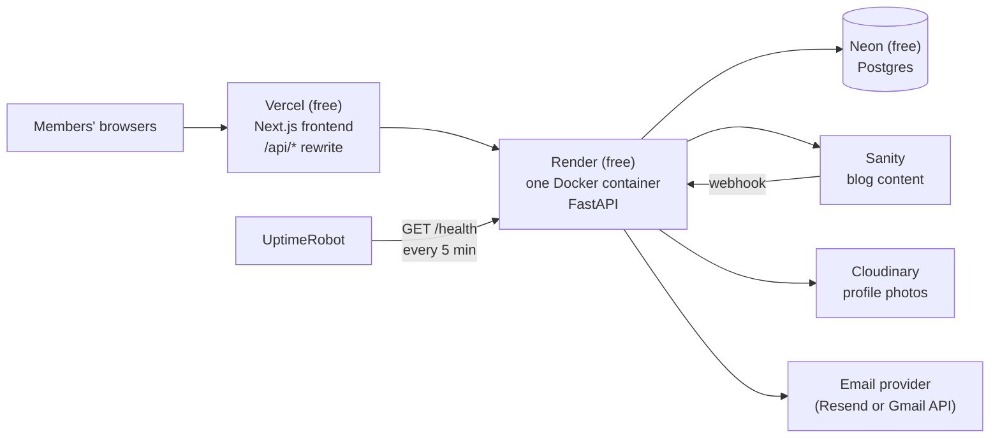

# Infrastructure

## The free-tier rule

**Everything runs on free tiers.** Before adding a service, a process or a paid feature, ask the team. This rule is why there's no Celery, no Redis and no background workers.

## Where things run

| Piece | Service | Notes |
|---|---|---|
| Frontend | Vercel | Proxies `/api/*` to the backend (see [Authentication](auth.md#why-the-vercel-proxy)) |
| Backend | Render free web service | One Docker container, one instance |
| Database | Neon free | Scales to zero when idle |
| Keep-awake | UptimeRobot | Pings `/health` every 5 minutes so Render doesn't put the app to sleep |
| Blog | Sanity | Private dataset; only our backend talks to it |
| Photos | Cloudinary | Profile photos only |
| Email | Resend or Gmail API | Not chosen yet; always over HTTPS |

## Free-tier limits we design around

- **Render free blocks outbound SMTP** (ports 25, 465, 587). Email must go through an HTTP API, which is why it's Resend or the Gmail API and never plain SMTP.
- **Render's disk is wiped on every restart.** Nothing is stored locally: data goes to Neon, photos to Cloudinary, posts to Sanity.
- **Render free has no pre-deploy step and runs a single instance.** The container's start command runs `alembic upgrade head` and then starts the server. That's safe with one instance.
- **Render free sleeps after 15 minutes without traffic.** UptimeRobot prevents this. **`/health` must never touch the database**, otherwise those pings would keep Neon awake too and burn through its free compute.
- **Neon scales to zero.** The first database query after a quiet period is a bit slower; that's expected.
- **Neon connection URLs:** the app uses the **pooled** URL (`DATABASE_URL`) and Alembic uses the **direct** URL (`DATABASE_URL_DIRECT`).

## Background work

There are no workers. The little background work we have is handled like this:

| Task | How |
|---|---|
| Sending login codes | During the request, with a short timeout and one retry |
| Deleting a replaced profile photo from Cloudinary | FastAPI `BackgroundTasks` (if it's ever lost, an unused image is left behind; that's harmless) |
| Cleaning up expired codes and sessions | Expired rows are ignored by their expiry time, and old rows are deleted during login. No scheduler needed. |

When a real scheduled feature arrives (e.g. birthday emails), a **scheduled GitHub Actions workflow** will call a protected endpoint. That's free, and it also wakes the app.

**GET requests never cause side effects** (no emails, no writes).

## Caching

Only **blog posts** are cached, and only on the **backend**.

- **What and where:** an in-memory cache (`cachetools.TTLCache`) in `posts/service.py`, limited in size.
- **The key is the query, never the user:** every member sees the same posts. Login and role checks always happen **before** the cache is consulted.
- **Cache misses read Sanity's live API,** not its CDN, so we don't stack two layers of staleness.
- **When the cache is cleared:**
  - after every successful post create, update or delete through our API
  - when Sanity sends a webhook (a backup, e.g. if someone edits in Sanity Studio)
  - automatically after **10 minutes** at the latest, as a safety net
- **Why in-memory works:** Render free runs exactly one instance, so there's one cache. With multiple instances, the cache would have to move to a shared store.

**Not cached:**
- **Postgres data** (users, wishes, sessions): queries are cheap at family scale, and stale or mixed-up user data would be worse than a few milliseconds.
- **The current-user lookup:** never cached, so deactivation and role changes apply instantly.

**HTTP caching:**
- Every authenticated response sends `Cache-Control: private, no-store`, so Vercel's proxy can never cache member data and serve it to someone else.
- Images load straight from Sanity's and Cloudinary's CDNs, which handle their own caching.

**Frontend (Next.js), for reference:**
- Per-user caching in the browser is fine (TanStack Query, SWR, the router cache). Clear it on logout.
- Static generation or ISR is fine for the public landing page.
- **Never** use Next.js or Vercel server-side caching for anything behind a login; it's shared between all visitors.

## CI

Every push and PR to `main` runs these checks, and all of them must pass before merging:

1. `ruff check .` and `ruff format --check .`
2. `pytest` against a Postgres service container
3. `alembic upgrade head` on a fresh database, then `alembic check` (catches model changes without a migration)
4. **Malware Guard:** the GitHub org was hit by malware in September 2026. This workflow fails if it finds the malware's persistence files (`.vscode/tasks.json`, `.bat` push scripts, `branch_structure.json`), any committed `.bat`/`.cmd`/`.ps1`/`.vbs` file, VS Code auto-run settings, obfuscated JavaScript, or "font" files that are really scripts.
5. mypy (optional for now)

Malware Guard (`malware-guard.yml`) and the CI workflow (`CI.yaml`: ruff and pytest with a Postgres service) are in place. The Alembic checks join CI once Alembic is set up.

> **Never commit** `.vscode/tasks.json`, VS Code auto-run settings or Windows script files. If you see any of these in the repo or on your machine, tell the team immediately.

## Local development

- **Database:** Postgres runs in Docker (`docker compose`, coming in an upcoming PR). Tests use it too.
- **Settings:** copy `.env.example` to `.env` and fill it in. Never commit `.env`.
- **Commands:** see [CONTRIBUTING.md](../CONTRIBUTING.md) and the commands section in [CLAUDE.md](../CLAUDE.md#commands).
