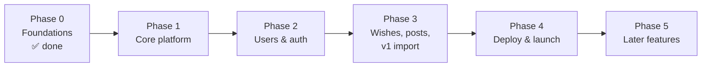

# Roadmap

How we get from today's scaffold to a live v2, as a team of **four developers**. The phases are ordered by dependency: each one unlocks the next. Inside a phase, work is split so all four people can move in parallel.

The developers are labelled **Dev A–D** here. Who takes which track is up to the team. A good rule is that whoever builds a feature in Phase 2 or 3 owns it afterwards (reviews, bug fixes).

## At a glance

| Phase | Goal | Done when |
|---|---|---|
| **0. Foundations** ✅ | Repo structure, dependencies, docs | Everyone can clone, `uv sync` and find where code goes |
| **1. Core platform** | Shared building blocks + guardrails | The app boots against local Postgres, migrations run, and CI blocks bad PRs |
| **2. Users & auth** | People can be registered and log in | An admin registers a member, who logs in on a new device with an emailed code |
| **3. Features** | Wishes, blog and v1 data | Every endpoint exists with tests, so the frontend can integrate |
| **4. Deploy & launch** | v2 live on the free stack | Members use production; v1 is retired |
| **5. Later** | Nice-to-haves | Each item is planned when it's picked up |

## Principles for working in parallel

- **The critical path is core → users → auth.** Almost everything depends on it. When someone on that path is blocked, unblocking them comes first.
- **Contracts before implementations.** We agree early on the *signatures* of shared pieces: `get_current_user`, `require_role`, the ownership check, and the `core/email.py`, `core/media.py` and `core/sanity.py` interfaces. Then wishes and posts can be built and tested with fakes before auth is finished.
- **One feature, one owner, one folder.** The feature-based layout means two people rarely edit the same files. Shared files (`main.py`, `core/`, `alembic/env.py`, `conftest.py`) get small, focused PRs.
- **Small PRs.** One deliverable per PR, reviewable in about 15 minutes, with tests and migrations included (see [CONTRIBUTING.md](../CONTRIBUTING.md)).
- **Decision gates are explicit.** Some work waits on an answer from outside the code. Those gates are listed per phase, so nobody builds on a guess.

---

## Phase 0: Foundations ✅

**Done:**
- `src/` feature-based layout and placeholder modules
- Dependency cleanup
- ruff/pytest/mypy settings
- Malware Guard workflow
- `docs/`, `CLAUDE.md` and an updated CONTRIBUTING.md

PRs #4, #5 and #6 cover this. `core/config.py` was started in #7, and a fix is in progress.

---

## Phase 1: Core platform

**Goal:** the shared building blocks every feature needs, plus the guardrails that stop broken code from reaching `main`. Nothing user-facing yet.

| Track | Deliverables |
|---|---|
| **Dev A: Database** | `core/db.py` (async engine, session factory, shared `Base`, `get_session`) · Alembic set up with the async template, using `DATABASE_URL_DIRECT` · `docker-compose.yml` with Postgres for local dev and tests |
| **Dev B: App setup** | `core/config.py` finished (the in-progress fix) · `core/exceptions.py` (base exceptions + handlers) · `main.py` wiring: CORS allowlist, `Cache-Control: private, no-store` on authenticated routes, proxy headers, router registration · `core/security.py` helpers (JWT, password hashing, hashing of codes and tokens) |
| **Dev C: Guardrails** | Main CI workflow (ruff, format check, pytest with a Postgres service, `alembic upgrade head` + `alembic check`) · branch protection on `main` (CI green + 1 approval) · `Dockerfile` (migrations then uvicorn on start) |
| **Dev D: Contracts & fixtures** | `conftest.py` fixtures (test DB with per-test rollback, async HTTP client, a way to "log in as" a user of any role) · stub signatures for `get_current_user`, `require_role` and the ownership check · interfaces + fakes for `core/email.py`, `core/media.py` and `core/sanity.py` |

**Order inside the phase:**
- Dev A's `db.py` and Docker Postgres come first, because the fixtures and Alembic need them.
- Dev C can start CI right away, and wire in pytest and Alembic as those land.

**Decision gates (start collecting now, needed in Phase 2–3):**
- Email: SMTP (chosen; server and account still to pick)
- Sub-family and promotion lists (done: decision 70)
- Sanity post schema fields

**Done when:**
- `docker compose up` gives a local Postgres, and `uv run alembic upgrade head` works against it.
- `uv run fastapi dev src/app/main.py` boots, and `/health` responds without touching the database.
- A sample test using the shared fixtures passes, both locally and in CI.
- PRs to `main` can't merge with failing CI.

---

## Phase 2: Users & auth (critical path)

**Goal:** admins can register people, and people can log in securely, once per device. See [Domain](domain.md) and [Authentication](auth.md) for the rules.

| Track | Deliverables |
|---|---|
| **Dev A: Users** | Models + migration for `users`, `sub_families` and `promotions` (lookup lists seeded by the migration) · admin user management: create, list, view, update, deactivate · visibility rules via separate schemas (`UserPublicRead` / `UserRead`) |
| **Dev B: Auth** | Models for `user_sessions` and verification codes · login → code → verify flow (with the password step for admins) · refresh with rotation and reuse detection · logout · list and revoke sessions · refresh cookie + `Origin` check · throttling in Postgres · real `get_current_user` / `require_role` / ownership check replacing the Phase 1 stubs |
| **Dev C: Profiles** | Members editing their own profile (photo, display name, birthday) · real Cloudinary implementation in `core/media.py`, including deleting replaced photos in the background · first-admin seed script in `scripts/` |
| **Dev D: Email** | Real provider in `core/email.py` once it's chosen · email-change flow (an admin changes the email → code to the new address → the user confirms) · then starts on wishes models (Phase 3) once the `users` model is merged |

**Dependencies:**
- **Dev A's `users` model is the first thing to merge in this phase.** Auth, profiles and wishes all reference it.
- **Dev B builds against the Phase 1 email fake.** The real provider (Dev D) can land independently.

**Decision gates:**
- **Sub-family and promotion lists:** done, seeded by a migration (decision 70).
- **Email:** SMTP is built (decision 68); only the server and account are still to pick. Tests use the fake.

**Done when:**
- The seeded admin logs in with family name + password + code.
- The admin registers a member, and the member logs in on a new device with an emailed code.
- The access token refreshes, the refresh token rotates, and reusing an old refresh token revokes the session.
- Deactivating a user blocks them immediately, on every device.
- A member can edit only their own profile.

---

## Phase 3: Features

**Goal:** everything members actually use. The tracks are independent, so this is the most parallel phase.

| Track | Deliverables |
|---|---|
| **Dev A: Wishes** | `wishes` model + migration (sender, recipient, year; one per sender/recipient/year) · post, edit and delete wishes with the 30-day window and ownership rules · upcoming birthdays (next 30 days, day/month visibility) |
| **Dev B: Posts (read side)** | Real `core/sanity.py` client · member reads (list + single post) · the in-memory posts cache (10-minute TTL) · Sanity webhook endpoint with signature check that clears the cache |
| **Dev C: Posts (write side)** | Create, update and delete posts for social media managers and admins · image uploads to Sanity assets · clearing the cache after every write |
| **Dev D: v1 import** | `scripts/import_v1.py` (MongoDB → `users`, idempotent; done: decision 71) · dry run against a Neon branch · mapping v1 sub-families to the fixed list · everyone arrives as a member, and the seeded admin promotes the others |

**Dependencies:**
- Dev B and Dev C share `posts/`: agree on `posts/schemas.py` and the cache helper first, then split along read and write.
- Dev D needs the final `users` model and the sub-family list.

**Decision gate:**
- **Sanity post schema fields:** needed before Dev B and Dev C start.

**Done when:**
- Every endpoint in the [Domain](domain.md) doc exists, with tests for success, auth, role and ownership failures.
- The frontend team can build every screen against the API (local or staging).
- The v1 import runs cleanly against a Neon branch.

---

## Phase 4: Deploy & launch

**Goal:** v2 live on the free stack, with real members using it.

| Track | Deliverables |
|---|---|
| **Dev A: Infrastructure** | Render free web service from the Docker image · production Neon database (pooled URL for the app, direct URL for migrations) and a Neon branch for staging · production env vars · UptimeRobot monitor on `/health` |
| **Dev B: Frontend integration** | Work with the frontend team on the `vercel.json` `/api/*` rewrite · verify the login flow end to end **on Safari/iPhone** (the refresh cookie) · keep the OpenAPI docs accurate |
| **Dev C: Hardening** | Security pass against [Authentication](auth.md): cookie flags, `Origin` check, throttling, no secrets or personal data in logs, `Cache-Control` on authenticated routes · error handling and log levels for production |
| **Dev D: Data & onboarding** | Seed the first admin, then run the v1 import on production · promote admins and social media managers, and help new admins set passwords · a short "how to log in" note for family members · retire v1 (Render service, MongoDB) once v2 is confirmed |

**Decision gate:**
- **SMTP must be configured in production** (`SMTP_*` and `EMAIL_FROM`). Without it, nobody can log in.

**Done when:**
- Members log in to production on their phones and stay logged in across days.
- The v1 data is in v2.
- v1 is switched off.

---

## Phase 5: Later features

These are picked up after launch, each planned when it starts:

- **Birthday emails:** a scheduled GitHub Actions workflow calls a protected endpoint. It's free and also wakes the app.
- **Slack integration,** e.g. posting upcoming birthdays.
- Anything new from the family committee. Add it to the Notion page first, then here.

---

## Keeping this roadmap useful

- **Track work as GitHub issues,** one per deliverable, labelled by phase (`phase-1`, …) and assigned to whoever picks it up.
- **When a phase's "done when" checks all pass,** mark the phase ✅ here in a small PR.
- **When plans change,** update this file and, if a design decision changed, [decisions.md](decisions.md) in the same PR.
- **Migrations across four people:** two PRs that each add a migration can create "multiple heads". Before merging, rebase on `main`, run `uv run alembic heads`, and fix it with `uv run alembic merge heads -m "merge heads"` if needed (see CONTRIBUTING §13).
